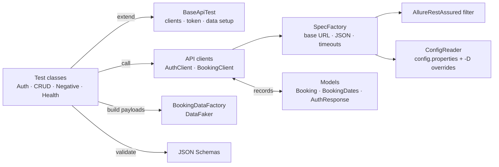
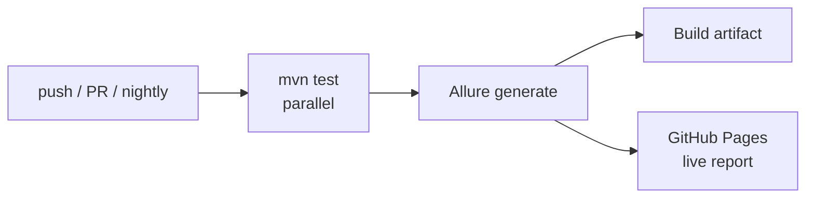

# Restful-Booker API Automation Framework

[](https://github.com/AishwaryaAni/restful-booker-api-automation/actions/workflows/api-tests.yml)
[](https://aishwaryaani.github.io/restful-booker-api-automation/)


An API test automation framework for the live **[Restful-Booker](https://restful-booker.herokuapp.com/apidoc/index.html)** hotel-booking API, built with **Java, REST Assured and TestNG**. It covers the full booking lifecycle — auth, create, read, update, patch, delete — plus security, error-handling and JSON-contract checks.

### 📊 [View the live Allure test report →](https://aishwaryaani.github.io/restful-booker-api-automation/)
Rebuilt and published automatically on every push and every night at 09:00 IST.

> Built by a QA Team Lead with 6 years of API, integration and database testing (Postman, REST Assured, Swagger). Each test mirrors how I'd write the manual test case: precondition → action → verify response → verify persistence.

---

## Highlights

- **Full CRUD lifecycle** — POST, GET, PUT, PATCH, DELETE, each verified at the response *and* re-fetched to confirm persistence
- **Token-based auth** — admin token fetched once per run, reused safely across parallel threads
- **JSON Schema contract tests** — catch breaking response changes, not just wrong values
- **Typed models with Java records** — one `assertEquals(response, request)` compares an entire payload
- **Fresh test data every run** with DataFaker — no hard-coded rows, no clashes on a shared public API
- **Security & negative coverage** — missing/invalid tokens, unknown ids, malformed payloads
- **Response-time SLA assertions**, configurable per environment
- **Parallel execution** — every test is independent and creates its own data
- **Allure reporting** — every request/response (headers, body, status) attached to the test that sent it
- **CI/CD** — GitHub Actions on push, PR and a nightly schedule; report auto-deployed to GitHub Pages

---

## Tech Stack

| Layer | Tool |
|---|---|
| Language | Java 17 (records) |
| HTTP / API DSL | REST Assured 5 |
| Test runner & assertions | TestNG 7 (`@DataProvider`, groups, parallel) |
| Serialisation | Jackson |
| Contract testing | REST Assured JSON Schema Validator |
| Test data | DataFaker |
| Reporting | Allure 2 (TestNG + REST Assured filter, AspectJ `@Step`) |
| Build | Maven (Surefire) |
| CI/CD | GitHub Actions → GitHub Pages |

---

## Architecture



| Layer | Responsibility | Never does |
|---|---|---|
| **Tests** | Decide *what* to verify; all assertions live here | Build URLs or headers |
| **Clients** | One method per endpoint; return the raw `Response` | Assert anything |
| **SpecFactory** | Shared base URL, headers, timeouts, reporting filter | Know about specific endpoints |
| **Models** | Typed request/response bodies (Java records) | Contain logic |
| **Data factory** | Generate valid, unique payloads | Call the API |

The API equivalent of the Page Object Model: **clients are to endpoints what page objects are to screens.**

---

## Project Structure

```
restful-booker-api-automation
├── .github/workflows/api-tests.yml        # CI: test → Allure → GitHub Pages
├── pom.xml
└── src
    ├── main/java/com/qa/api
    │   ├── config/ConfigReader.java
    │   ├── client
    │   │   ├── SpecFactory.java            # shared request spec
    │   │   ├── AuthClient.java             # POST /auth + token cache
    │   │   └── BookingClient.java          # /booking endpoints
    │   ├── models                          # Java records
    │   │   ├── Booking.java · BookingDates.java · BookingResponse.java
    │   │   └── AuthRequest.java · AuthResponse.java
    │   └── data/BookingDataFactory.java    # DataFaker test data
    └── test
        ├── java/com/qa/api
        │   ├── base/BaseApiTest.java
        │   └── tests
        │       ├── HealthCheckTest.java
        │       ├── AuthTest.java
        │       ├── BookingCrudTest.java
        │       └── BookingNegativeTest.java
        └── resources
            ├── config.properties
            ├── testng.xml · testng-smoke.xml
            └── schemas/booking.json · create-booking-response.json
```

---

## Test Coverage

**15 test executions** across 4 classes (smoke subset: 4).

| Area | Test | Verifies |
|---|---|---|
| Health | `serviceIsUp` | `GET /ping` → 201 within SLA |
| Auth | `validCredentialsReturnToken` | Token issued, no failure reason |
| Auth | `invalidCredentialsAreRejected` ×3 | Wrong password / unknown user / empty → no token, reason "Bad credentials" |
| CRUD | `createBooking` | 200, schema, SLA, stored body = sent body |
| CRUD | `getBookingById` | 200, schema, matches created booking |
| CRUD | `listIncludesNewBooking` | New id appears in `GET /booking` |
| CRUD | `fullUpdateBooking` | PUT replaces booking; change persisted on re-fetch |
| CRUD | `partialUpdateBooking` | PATCH changes only `firstname`; all other fields untouched |
| CRUD | `deleteBooking` | DELETE → 201; follow-up GET → 404 |
| Security | `updateWithoutTokenIsForbidden` | 403, and the booking is **not** modified |
| Security | `deleteWithInvalidTokenIsForbidden` | 403, and the booking still exists |
| Errors | `getNonExistentBookingReturns404` | Unknown id → 404 |
| Errors | `incompletePayloadIsRejected` | Malformed body is rejected (see findings) |

### From manual API test case to automated check

| Manual step (Postman) | Automated equivalent |
|---|---|
| Set base URL + headers in the collection | `SpecFactory.baseSpec()` |
| Get a token, paste it into the next request | `AuthClient.adminToken()` — cached, thread-safe |
| Check status code | `.statusCode(200)` |
| Eyeball the response body | Deserialise to a record → `assertEquals(actual, expected)` |
| "Does the response still look the same?" | JSON Schema validation |
| Check the response time in the corner | `.time(lessThan(slaMs))` |
| Re-open the record to confirm the save | Re-fetch with `GET` after `PUT` / `DELETE` |
| Same request, different inputs | TestNG `@DataProvider` |

---

## API Findings 🐞

Real behaviour discovered while automating, documented in the tests:

| Finding | Expected | Actual | How the suite handles it |
|---|---|---|---|
| Bad credentials on `POST /auth` | 401 Unauthorized | **200** + `{"reason":"Bad credentials"}` | Asserts no token is issued |
| Incomplete payload on `POST /booking` | 400 Bad Request | **500** Internal Server Error | Asserts rejection (≥ 400); flagged as known defect |
| Successful `DELETE` | 200 / 204 | **201** Created | Pinned to actual behaviour |

---

## Getting Started

### Prerequisites
- **JDK 17+** — `java -version`
- **Maven 3.8+** — `mvn -v`
- *(Optional)* **Allure CLI** to view reports locally — `npm i -g allure-commandline` or `brew install allure`

### Run

```bash
git clone https://github.com/AishwaryaAni/restful-booker-api-automation.git
cd restful-booker-api-automation

# Full regression (parallel)
mvn clean test

# Smoke only
mvn clean test -Dsuite=testng-smoke.xml

# Single class
mvn clean test -Dtest=BookingCrudTest

# Another environment / stricter SLA
mvn clean test -DbaseUrl=https://my-qa-host -Dsla.response.ms=1500
```

### View the report locally

```bash
allure serve target/allure-results
```

---

## CI/CD Pipeline



- Runs on every push and PR to `main`, nightly at 09:00 IST, and on demand (choose smoke or regression).
- The report is published **even when tests fail**, so a red build always comes with evidence.

---

## Configuration

| Key | Default | Purpose |
|---|---|---|
| `baseUrl` | `https://restful-booker.herokuapp.com` | Target environment |
| `auth.username` / `auth.password` | public demo credentials | Admin login (use GitHub Secrets for real systems) |
| `sla.response.ms` | `5000` | Response-time assertion |
| `http.timeout.ms` | `20000` | Connection / socket timeout |

Any key can be overridden with `-Dkey=value`.

---

## Roadmap

- [ ] Allure history trend across runs
- [ ] Data-driven payloads from JSON files
- [ ] Contract tests against an OpenAPI spec
- [ ] Database validation layer (verify API writes in the DB)

---

## Related

🖥️ UI automation counterpart: **[saucedemo-selenium-framework](https://github.com/AishwaryaAni/saucedemo-selenium-framework)** — Selenium WebDriver + TestNG, Page Object Model.

## Author

**Aishwarya Anil** — Senior QA Engineer · QA Team Lead
Manual · API · Database · UI Automation

[LinkedIn](https://linkedin.com/in/aishwarya-anil20) · [GitHub](https://github.com/AishwaryaAni)
